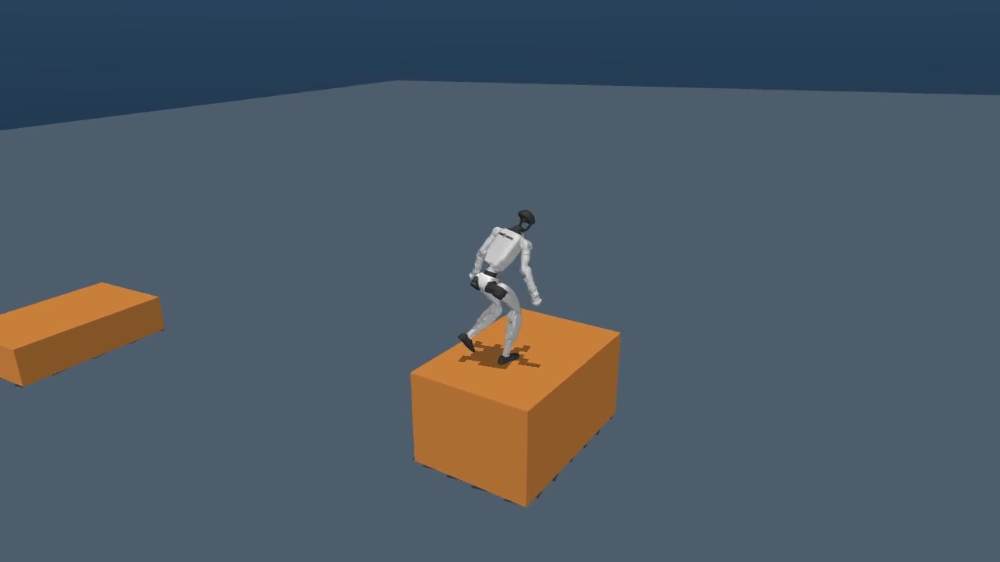
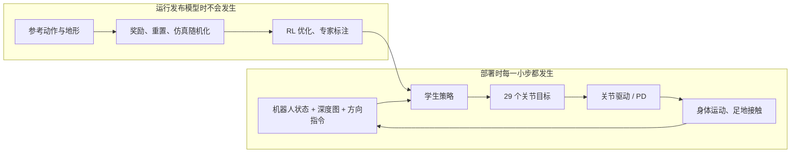
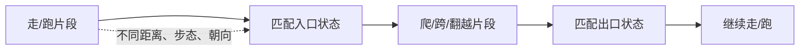
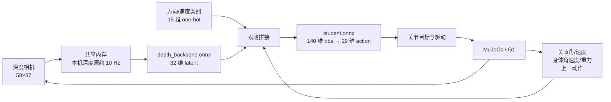

# 从 VLA 到人形全身运动控制：PHP Parkour 入门

> 适合已经接触过 π₀.₅ 一类 VLA、策略推理和机器人数据，但还没有系统学习 locomotion、接触动力学与强化学习的读者。本文以**本仓库的代码和已经执行的 MuJoCo 复现**为线索。文中的“论文方法”“仓库训练配方”“本机实测”分别标明；三者不是同一份实验结果。
>
> 阅读时间约 45–90 分钟。建议先看 [v2 实体仿真视频](demos/phase1-onnx-guided016-v2/demo.mp4)，边看边读第 1、3、8、10 节；训练相关章节可以第二遍再读。



上图来自本机官方 ONNX 模型的一次 MuJoCo 评测。橙色是**有碰撞的实体台阶**，蓝灰色是地面；颜色只服务于观看。这个试次的严格连续成绩是 **2/12**，当前最好的一次合格试次是旧版视频的 **5/12**。图片说明的是系统长什么样，不能替代逐块评分。[视频与记录如何对应](DEMO_VIDEO_WORKFLOW.md)、[所有关键试次](PHASE1_TRIAL_LOG.md)另有详细说明。

## 0. 先建立全局地图

PHP 是 *Perceptive Humanoid Parkour*。它想让人形机器人凭机载深度感知，在接近障碍时自己选出合适的跨、爬、翻越动作，并在多个障碍之间继续行走。论文方法有三个先后关系非常清楚的阶段：[论文](https://arxiv.org/html/2602.15827v2)、[项目 README](README.md)。


这里最容易混淆的点是：**motion matching 主要负责离线制造训练参考动作；本次部署的 ONNX 学生不是每走一步都去数据库里检索动作片段。** 教师在训练时能看见仿真提供的“特权信息”；部署学生只能使用实际可获得的本体状态、深度图和方向指令。我们目前只完成了图中“使用发布 ONNX 在 MuJoCo 运行并评测”的第一阶段复现，**没有重新训练教师或学生**。

可以把整套系统拆成两个环：



在线闭环要在物理时间内不停运行；离线训练可以在成千上万个并行环境里反复摔倒、重置、更新参数。把两者分开，能避免“看见机器人走起来了，就以为训练配方也复现了”的误解。

## 1. 从你熟悉的 VLA 看 locomotion

你熟悉的 VLA 通常要把视觉和语言/任务条件映射到机器人动作。PHP 的部署学生也属于视觉条件策略，但它解决的是**持续、快速、接触丰富的全身运动**，任务条件主要是离散方向/速度指令，而不是语言。你本机 `src` 中有 VLA、触觉、机器人描述、仿真和手部 RL 相关工程；因此下表强调接口和闭环差异，不重复介绍“什么是策略网络”。

| 维度 | 常见 VLA 操作任务的思考方式 | 这里的人形 locomotion |
|---|---|---|
| 任务单位 | 抓取、放置、操作物体等较长语义任务 | 每一步同时维持平衡、预测落脚、越障、恢复 |
| 决策条件 | 图像、语言、任务状态、历史 | 深度图、本体感觉、离散速度/方向指令、历史动作 |
| 网络动作 | 末端位姿、关节动作或动作 chunk，依模型而定 | 本仓库发布学生输出 29 个关节动作，经缩放得到关节目标 |
| 错误代价 | 一步失误可能还能重新定位或重抓 | 脚一滑、重心一偏，下一帧的状态已经改变，可能立即跌倒 |
| 关键物理 | 接触与力也重要，但通常可在较慢任务节奏下处理 | 足底摩擦、冲量、关节速度/力矩上限、身体角动量直接决定成败 |
| 常见学习路径 | 大规模示范/预训练 + 微调 | 仿真 RL、动作跟踪、教师学生蒸馏和域随机化 |
| 评估 | 任务成功率、语言泛化、操作误差 | 姿态、接触、落脚、是否越障后仍站立，以及跨多个障碍的稳定性 |

一个有用的迁移：把 `depth_backbone.onnx` 看成视觉编码器，把 `student.onnx` 看成快速动作头；但这里动作头后面**必须有执行器和物理世界**。给网络相同图像，不意味着它会给出相同“可执行效果”：关节参数、摩擦、延迟、脚底接触和姿态初值都会改变下一帧状态。

## 2. 机器人身体到底是什么状态？

### 2.1 刚体、关节、自由根

G1 不是 29 个互不相关的电机。它由骨盆、躯干、双腿、双臂等刚体和关节连起来；各部件的质量、惯量和碰撞几何都影响动作。此仓库使用 **29-DOF G1**，即 29 个受控关节自由度，具体顺序见 [robot_config.py](wbt_training/config_values/robot_config.py)。骨盆/根节点还在空间中平移和旋转：3 个位置数、4 个四元数数值，因此 MuJoCo 的位置向量长度是 `7 + 29 = 36`；对应速度向量是 `6 + 29 = 35`。**四元数虽有 4 个数，只表示 3 个转动自由度**，要满足单位长度约束。不要把 `nq=36` 当成 36 个可直接驱动的电机。

关节角 `q` 的单位通常是弧度，关节角速度 `q̇` 是弧度/秒；根节点世界位置的单位是米。`world` 坐标系描述“地面固定不动时机器人在哪里”，`body` 或根节点坐标系描述“相对于机器人朝向，前方/左方在哪里”。本机评分里的 `x` 是默认路线的前进方向，`y` 是横向偏移；`y=1.2 m` 不是“模型误差 1.2”，而是机器人在世界里偏出了路线。

一个简单例子：机器人面朝世界 `+X` 时，“向前”大致增加世界 `x`；若身体已经偏航 45°，同样的“向前”会同时改变 `x` 和 `y`。因此只看前进距离或只调“往前”指令，无法判断它有没有真正跨过台阶。这也是我们持续记录骨盆朝向、横向速度和首次出块位置的原因。

### 2.2 为什么站立都需要控制？

无支撑的人形机器人是浮动基座系统：机身并没有固定在地面上。脚与地面接触时，地面通过法向力和摩擦力支撑身体；脚离地、打滑、绊住边缘时，这些力会突变。倒下并不是“图像识别错误”这一种情况：可能是重心投影离开有效支撑区、关节来不及制动、脚底摩擦不足、接触求解/延迟造成时机变化，也可能是策略在不熟悉的姿态下输出了不合适的目标。

静态站立时，可以初步想象重心投影落在支撑脚围成的区域里；**跑酷不能只用静态支撑多边形判断**。跃起时短暂没有地面支撑，翻越时手和障碍物也可能形成接触，速度和角动量决定后续能不能稳住。把“稳”理解成*整个运动轨迹和接触序列*，比只盯一张站立截图更准确。

### 2.3 接触不是一个平滑的附加项

落脚前后，约束集合会突然变化：足底无接触 → 足底有接触；爬墙时手掌可能先着墙、再换成脚支撑。仿真器在每个物理步里求解关节动力学和接触力。地形 OBJ 既有**视觉网格**也承担**碰撞几何**；把它在窗口里画成线框，只改变人看到的样子，不能说明碰撞不存在。我们上一版视频里的线框问题就是查看器快捷键冲突，已在 v2 的独立回放里改用实体显示，原评测碰撞几何并未改动。[MuJoCo 官方概览](https://mujoco.readthedocs.io/en/stable/overview.html)介绍了广义坐标、接触和仿真模型的关系。

## 3. 策略动作、关节目标与 PD：三个层次不要混成一个

此项目不是让 ONNX 直接决定机器人在世界中的下一帧位置。训练动作在仓库配方中是**关节位置目标**。可以先用以下概念式理解：

```text
网络动作 a_t ∈ R^29
目标角度 q_target = q_default + action_scale ⊙ a_t
近似关节力矩 τ = Kp ⊙ (q_target - q) - Kd ⊙ q̇
实际执行再受电机力矩/速度上限、滤波、延迟和驱动实现约束
```

第一行只是网络输出；第二行把无量纲动作变成每个关节的目标角；第三行说明底层位置伺服的直觉：偏离目标越多，回复力矩越大；转得越快，阻尼越大。实际训练 preset 使用 IsaacSim 的 implicit position target 驱动，部署侧按导出元数据解析 `joint_names`、`action_scale` 和控制增益；不同 preset 不可随意混用。例如 [训练入口](wbt_training/training_runs/run_terrain_teacher.sh)选的是 `g1-wbt-terrain-ref-noscale`，其有效 `action_scale=1.0`；[experiment.py](wbt_training/config_values/experiment.py)还保留缩放为 0.25 的兼容变体。**动作缩放错了，即使网络权重完全正确，落脚也可能完全不同。**

`Kp` 太低会跟不上快速抬腿，太高可能放大冲击、接触误差和执行器饱和；`Kd` 太低会振荡，太高会让运动发黏。人形控制还要核对关节顺序：训练环境的关节数组顺序与 MuJoCo/硬件顺序可能不同，[部署策略](thirdparty/holosoma/src/holosoma_inference/holosoma_inference/policies/depth_distillation.py)根据 ONNX 元数据进行重排。顺序错位是严重接口错误：髋关节的目标被送到膝关节，看起来会像“模型不会走”，但根因在数据对齐。

控制还有时间尺度。**本机这一套**通常以约 500 Hz 前进 MuJoCo 物理仿真，以约 50 Hz 调用学生策略，深度共享内存源以约 10 Hz 更新，视频是 30 fps。换算为周期分别约 2 ms、20 ms、100 ms、33 ms。它们各有不同职责：

| 约 100 ms 物理时间内 | 大致发生次数 | 用途 |
|---|---:|---|
| 500 Hz 物理步 | 50 次 | 积分动力学、处理接触和关节驱动 |
| 50 Hz 策略步 | 5 次 | 根据最近观测生成新的 29 维动作 |
| 10 Hz 深度更新 | 1 次 | 更新本机推理所用的地形视觉输入 |
| 30 fps 视频采样 | 3 帧 | 从保存的状态生成供人观看的画面 |

视频 30 fps 看着顺，不代表策略真的 30 Hz，也不代表深度每帧都更新。反过来，旧片只有 8 fps 而物理循环仍接近 500 Hz，所以“视频一卡一卡”不能直接诊断控制回路卡顿。论文讨论的实机深度相机为 30 Hz；本机默认 sim2sim 配置的 10 Hz **不能写成论文同等传感器频率**。[本机速率审计](demos/phase1-onnx-guided016-v2/audit.json)可核对一次实际运行。

## 4. 仿真在做什么，为什么 sim2sim 还会失败？

一个仿真环境至少由四类东西组成：机器人形体/惯量/关节/电机；地形和碰撞；传感器模型；时间推进和重置规则。MuJoCo、IsaacSim 会用各自的求解器和实现让“相同策略”在模型世界里运动。**同一个物理场景不等于逐帧相同轨迹**：接触参数、碰撞网格、数值积分、关节增益、相机外参、状态初始化都会造成差别，而且闭环误差会不断累积。

论文与仓库训练配方主要使用 IsaacSim（批量并行环境）训练教师和学生；本机已做的是把**发布的 ONNX 学生**放在 Holosoma/MuJoCo 流程里运行。因此这里叫 **sim2sim**：从一个仿真/训练栈迁移到另一个仿真/推理栈。**sim2real** 还要面对真实电机、结构形变、摩擦、视觉噪声、时延、安全约束，不能由一段 MuJoCo 视频证明。[仓库训练说明](wbt_training/README.md)、[部署说明](wbt_training/DEPLOY.md)对两套运行环境有明确区分。

训练中常用 *domain randomization*（域随机化）：在合理范围内改变摩擦、恢复系数、质心、初始状态、传感器外参等，使策略不只记住一组完美参数。例如 [terrain.py](wbt_training/config_values/terrain.py)列出静摩擦 0.4–1.3、动态摩擦 0.4–1.1、基础质心偏移和初始姿态噪声。这里的目的不是“随机越多越好”：随机区间过宽会让可学任务变得不真实或不稳定，过窄则可能过拟合仿真。

你可以把 sim2sim 排障分成三层，顺序很重要：

1. **接口一致**：ONNX 两文件是否配对？深度分辨率/归一化、观测拼接、关节顺序、动作缩放、控制增益是否与权重元数据一致？
2. **闭环质量**：物理和策略速率是否达标？深度帧是否过期？初始化、悬挂架释放、共享内存、DDS 是否正常？
3. **能力表现**：是否真正登上且离开台阶后仍站立？在哪里开始横向漂移？失败是否可重复？

如果第一层错误，调奖励或重新训练不会解决问题；如果第二层运行不稳定，一次成功/失败也不适合评价策略能力。

## 5. 强化学习：从一次摔倒到策略参数更新

### 5.1 MDP / POMDP 在这里分别对应什么

强化学习把连续控制看成反复循环：环境处于状态 `s_t`，策略得到观测 `o_t`，输出动作 `a_t`，环境执行后到 `s_{t+1}`，给奖励 `r_t`，必要时终止并重置。完整仿真状态可能包含所有刚体位置、速度、接触力和地形；机器人部署时看不到全部，因此学生面对的是**部分可观测问题**。论文教师可使用地形高度扫描、参考动作误差等特权量，学生只能依靠深度图和本体感觉估计自己该怎么动。[论文 §III-C](https://arxiv.org/html/2602.15827v2)、[本仓库观测定义](wbt_training/config_values/depth_distillation.py)。

一个 episode 可以是“从站立出发直到跌倒、跟踪误差过大或时间耗尽”。优化目标可写成 `E[Σ γ^t r_t]`。`γ` 是未来奖励折扣系数；这里论文表格与仓库配方使用 `γ=0.99`。这不是“每一步奖励越高越好”这么简单：高速跨障动作可能在某一步看起来更费力，却能换来后续不摔倒的长期收益。

### 5.2 奖励、终止、课程：各管一件事

参考动作跟踪奖励会鼓励机器人姿态和速度接近目标；关节极限、动作抖动、不希望的身体碰撞会被惩罚。论文给出的一个位置跟踪项形如 `exp(-||位置误差||²/σ²)`：误差为 0 时得 1；当误差等于 `σ` 时约 0.368；误差是 `2σ` 时仅约 0.018。这样靠近参考比远离参考更有奖励梯度。[论文附录奖励表](https://arxiv.org/html/2602.15827v2)给出具体项；[terrain.py](wbt_training/config_values/terrain.py)在 Holosoma 基础奖励上增加全局位置/朝向跟踪和关节极限、非期望接触项。

**奖励不是评测指标。** 策略可以凭奖励学习，但最后仍要独立评估“有没有越过障碍、越过后是否站稳”。**终止也不是简单的惩罚项。** 当跟踪误差过大时，训练环境提早重置，避免把大量已经完全偏离参考的状态算进同一个 episode；对应配置见 `bad_tracking`。课程学习逐渐让任务更难或放松过严的终止阈值：学生早期还不稳定，如果一出现轻微偏差就重置，可能永远收集不到有用的后段经验。[课程配置](wbt_training/config_values/depth_distillation.py)把某些阈值在训练区间里逐步放松。

一个值得记住的失败模式是 *reward hacking*：如果只奖励 x 增加，机器人可能绕过台阶、滑到路线外，仍拿到看似不错的前进距离。我们本机就有“x 已经很大，但并未连续越障”的试次。因此 `max_x` 与 `consecutive_cleared` 必须分开报告。

### 5.3 PPO 用怎样的反馈更新策略？

PPO（Proximal Policy Optimization）是这里训练配方使用的 on-policy 策略优化方法。直觉上，旧策略在许多并行仿真环境中采样轨迹；critic 估计某状态之后的平均回报；优势函数 `A_t` 判断“这次动作比当时的平均预期好多少”；actor 按优势方向改概率，同时通过**裁剪**限制每次更新离旧策略太远。常见形式中的概率比 `ρ_t = π_new(a_t|o_t) / π_old(a_t|o_t)` 被限制在以 1 为中心的区域，以降低一次更新把行走策略彻底改坏的风险。训练代码还涉及 GAE、熵奖励、KL 目标和 mini-batch。此处先理解数据流，之后再读 [PPO 原论文](https://arxiv.org/abs/1707.06347)的公式。

PPO 不会替你定义“好动作”。奖励、重置、观测和动作接口决定它到底优化什么。另一个重要限制是 **on-policy 数据要由当前策略在环境中重新采集**；已经导出的 ONNX 文件只能推理，不能在本机反复放视频就自动改进参数。

## 6. PHP 的三阶段学习，逐层拆开

### 6.1 阶段 A：motion matching 生成*参考*，不是力控

少量真人跑酷片段先被重定向到 G1 关节空间。单段动作可能只包含“爬上箱子”或“跑一段”；为了训练长路线，需要不同起步距离、左右脚领先、方向和过渡。Motion matching 给数据库每帧算一个特征向量，包括未来根节点路线/朝向、脚的位置/速度和身体速度；根据当前姿态和想走的方向，在限定候选集里找最近帧，再平滑接上。[论文 §III-B](https://arxiv.org/html/2602.15827v2)将它表述为最近邻检索。



合成结果是随时间变化的目标姿态 `q_ref(t)`，同时配有障碍地形和方向命令。**它仍是运动学参考，不保证物理可执行。** 比如人体动作重定向后某脚可能恰好穿进障碍物，或转接帧在速度上不连续；后续物理 RL 教师需要在接触和电机限制下把参考“演出来”，必要时调整细节。仓库的 [motion_matching/README.md](motion_matching/README.md)说明数据库、场景和生成文件，准备好的数据包也可直接用于训练。

### 6.2 阶段 B：每个技能训练 privileged teacher

教师是会看“答案”的训练代理：它得到参考关节/骨盆信息及地形高度扫描等仿真特权观测，在 IsaacSim 并行环境中通过 RL 学习跟踪参考动作。高度扫描可直观理解为脚下/附近的地面高度图；真实机器人没有一个直接读出完美地形网格的传感器，所以不能把该教师直接当成部署策略。具体观测见 [terrain.py](wbt_training/config_values/terrain.py)：`motion_ref_pos_b`、`motion_ref_ori_b`、`dof_pos`、`dof_vel`、`actions`、`height_scan` 等；critic 也使用训练时可用的特权信息。

为什么不直接训练一个学生从零学会全部技能？高墙攀爬需要在短时间内做出强烈且有顺序的全身动作，纯随机探索很难碰到成功样本。参考动作把探索范围缩到有希望的轨迹附近；单技能专家先把它们学熟，再交给学生汇总。论文还强调对困难片段的自适应采样，否则失败区域被采得太少。[论文教师训练小节](https://arxiv.org/html/2602.15827v2)。

### 6.3 阶段 C：统一深度学生，DAgger + PPO

学生在部署时没有教师的真实高度扫描，只看**深度图 + 本体感觉 + 方向命令**。训练时让学生自己跑进会遇到的状态，再请对应教师给出动作标签，更新学生：这就是 DAgger 的核心动机。与“只在教师演示轨迹上做一次行为克隆”相比，DAgger 让训练数据更覆盖学生自己造成的偏差。[DAgger 原论文](https://proceedings.mlr.press/v15/ross11a.html)。

但 PHP 论文指出，**只最小化逐帧模仿误差，可能不鼓励关键时刻用更大动作跨过障碍**。因此它给学生加上 PPO 的 episode 成败反馈。可以把两种信号并列看：

| 信号 | 回答的问题 | 可能的盲点 |
|---|---|---|
| DAgger/教师动作 MSE | “同一个局部状态，专家会怎么做？” | 两个动作距教师同样近，但一个能越过高墙、另一个会碰墙 |
| PPO/回报优势 | “整段运动最终有没有完成目标？” | 纯靠探索很难发现高难动作，训练成本大 |

仓库还有精细的专家路由：`which_motion` 选择该询问哪个专家；当学生跑到专家已经不可靠的状态时，屏蔽那部分 DAgger 损失，不拿错误标签逼学生模仿。[student_teacher.py](wbt_training/utils/student_teacher.py)、[motion_command.py](wbt_training/config_values/motion_command.py)。部署时不再调用这些教师；只运行导出的学生。

**论文表格与仓库当前 preset 必须区分。** 论文附录列的教师/学生最大迭代数都是 20,000；本仓库 [experiment.py](wbt_training/config_values/experiment.py) 的 `g1-wbt-terrain-warp-distill-finetune` 配置可见 30,000 次迭代，且还保留 pure-DAgger 变体。将来若做“按代码配方重新训练”，应记录实际 preset、提交和有效参数，不能用论文表格代替运行配置。此前用户指定只做发布模型复现，所以**本文讲解训练，但当前未启动训练**。

## 7. 两个 ONNX 文件在推理时怎样接起来？

发布的 `depth_backbone.onnx` 和 `student.onnx` 是一个复合策略，缺一不可。我们已核对这对发布模型的接口：深度输入约 `1×58×87`，backbone 输出 32 维潜变量；学生的 `obs` 输入为 `1×140`，另有 `time_step` 输入，输出 29 维动作。[部署实现](thirdparty/holosoma/src/holosoma_inference/holosoma_inference/policies/depth_distillation.py)、[本机核验](PHP_REPRODUCTION_GUIDE.md)。140 维可以直观拆为本体观测 93 维、方向 one-hot 15 维、深度潜变量 32 维：`93 + 15 + 32 = 140`。其中 93 维来自重力方向/姿态提示 3、基座角速度 3、29 个关节角、29 个关节速度、前一次 29 维动作。实际拼接顺序必须以部署实现和模型元数据为准，不能只凭维度相等就认为数据正确。



这里 `w/s/a/d/q/e` 在策略端是**离散方向类别**，不是简单给每一步 `x` 坐标加 0.1；W、W、S 会先选择前进、再选择前进、最后选择后退/站立，不能拿来“抵消一次可视化快捷键”。我们做过一次短测验证了这个问题，已撤回该做法。另一个输入陷阱是键盘焦点：MuJoCo 窗口和策略终端都可能收到某些按键。今后对控制效果作比较，应固定同一输入路径并记录所有方向事件。

## 8. 从零阅读本仓库：一条实际可走的路线

| 顺序 | 看哪份文件 | 看懂后应该能回答 |
|---|---|---|
| 1 | [README.md](README.md)、[本篇](PHP_HUMANOID_LOCOMOTION_BEGINNER_GUIDE.md) | 三阶段各产出什么？当前正在复现哪一阶段？ |
| 2 | [DEPLOY.md](wbt_training/DEPLOY.md) | 两个 ONNX、深度共享内存、仿真和推理进程怎样连起来？ |
| 3 | [depth_distillation.py](thirdparty/holosoma/src/holosoma_inference/holosoma_inference/policies/depth_distillation.py) | 58×87 深度如何变成 32 维；140 维 obs 如何拼；29 维动作如何重排？ |
| 4 | [terrain.py](wbt_training/config_values/terrain.py)、[depth_distillation.py 配置](wbt_training/config_values/depth_distillation.py) | 教师和学生分别看到什么；奖励、终止和随机化在哪里？ |
| 5 | [experiment.py](wbt_training/config_values/experiment.py)、[两个训练启动脚本](wbt_training/README.md) | 实际 preset 是哪个、action scale 多大、PPO 与 DAgger 哪个启用？ |
| 6 | [motion_matching/README.md](motion_matching/README.md) | 参考动作与配对地形怎样生成？ |
| 7 | [自动评测器](scripts/php_official_benchmark.py)、[评分器](scripts/php_score_course.py) | “运行起来”和“连续越障成功”之间差哪几道证据？ |

`thirdparty/holosoma` 是 Git submodule。这个工程使用它的固定提交；如果克隆后目录是空的，要先运行 `git submodule update --init --recursive`。即便你在本机 `php` 环境里能运行推理，也不要把 `motion_matching`、IsaacSim 训练依赖全塞进同一个环境：各子工程对 NumPy、CUDA 和 Python 的要求不同。[复现指南](PHP_REPRODUCTION_GUIDE.md)记录了本机已装的推理环境与踩过的坑。

## 9. 亲手复核 v2：先从无需训练的步骤开始

**第一步：看视频，不启动仿真。** [v2 视频](demos/phase1-onnx-guided016-v2/demo.mp4)是 30 fps、1280×720 的同次状态回放；[海报](demos/phase1-onnx-guided016-v2/poster.jpg)能看清障碍。看第 3 块时，重点观察机器人是否真正保持在障碍和路线内，不要只注意它“走了多远”。

**第二步：核对它的成绩来自同一次运行。** `demos/phase1-onnx-guided016-v2/` 包含压缩模型与关节状态、原始窗口录屏、`pelvis.csv`、`course_score.json`、`audit.json` 和 [manifest.json](demos/phase1-onnx-guided016-v2/manifest.json) 的 SHA-256。可以直接查看 [逐块评分](demos/phase1-onnx-guided016-v2/course_score.json)：试次 030 的第 1、2 块通过；第 3 块虽然登上，但首次离开时 `y=+1.133 m`，超过我们设置的 `±1 m` 路线判据，连续数停在 2。旧版 025 的 [视频](demos/phase1-onnx-guided016-v1/demo.mp4)是当前最好的一次合格 5/12，尚未稳定复现。

若 `php` 环境可用，从仓库根目录独立重算打包轨迹：

```bash
/home/xense/miniforge3/envs/php/bin/python scripts/php_score_course.py \
  demos/phase1-onnx-guided016-v2/pelvis.csv \
  --output /tmp/php-v2-score-check.json
```

**第三步：只在要操作镜头时打开交互回放。**

```bash
cd /home/xense/src/php_parkour
/home/xense/miniforge3/envs/php/bin/python scripts/php_open_demo.py \
  --trial demos/phase1-onnx-guided016-v2
```

终端会打印本机 `http://127.0.0.1:6081/...` 地址。浏览器拖动可旋转，滚轮缩放；Space 播放/暂停，R 重播，左右箭头前后跳 5 秒，Home 复位镜头。它运行在独立 `:99` 虚拟显示器，不抢办公桌面；但 Xvfb 软件显示会占用多个 CPU 核，**看完按 Ctrl-C 关闭**。若 `/tmp` 中临时解包的 Xvfb/noVNC 被系统清理，请按 [演示流程](DEMO_VIDEO_WORKFLOW.md)恢复依赖。交互是对同一条关节轨迹的查看，拖动镜头不会重新运行或改写策略成绩。

**第四步：再尝试新评测。** 只有在办公主机资源允许时，才按 [复现指南](PHP_REPRODUCTION_GUIDE.md)和 [阶段一计划](PHASE1_REPRODUCTION_PLAN.md)运行官方发布 ONNX。不要从 v2 回放画面估计新试次的成功率；每个新试次都要单独保留 `result.json`、轨迹、逐块评分、仿真/策略日志和视频。

## 10. 怎样判断一次“复现成功”？

同一句“复现了”至少可能指四件不同的事：

| 层级 | 已有证据 | 不能据此声称 |
|---|---|---|
| 环境和接口跑通 | `php` 环境、官方 ONNX 验证通过；深度、桥接、MuJoCo 与策略连通 | 策略已经达到论文效果 |
| 单障碍技能存在 | 0.38 m、0.76 m 单块诊断中观察到越障 | 默认长路线能连续完成 |
| 默认路线阶段性成绩 | 质量合格的一次严格连续 5/12；新试次 2/12、1/12 显示波动 | 5/12 是稳定成功率，更不能写成 12/12 |
| 官方完整效果 | 需要默认路线连续越过 12 块，最后障碍之后仍稳定，并做多次重复 | 目前没有这项证据 |

我们的评分是一个**明确但有限的操作性定义**：[php_score_course.py](scripts/php_score_course.py)先在台阶投影范围内看到骨盆高过障碍顶面至少 0.45 m，之后取**首次**到达该台阶末端 `+1.5 m` 的采样，要求骨盆高度至少 0.55 m 且横向 `|y|≤1 m`。偏出去以后再回来，记录为恢复，但不把首次出块改判通过；这防止绕行或跌倒后爬回路线被误报成越障。它只用骨盆轨迹和地形几何，**没有验证足底接触是否正确**，也不能直接与论文在不同仿真设置下的成功率比较。[论文的单障碍评估定义](https://arxiv.org/html/2602.15827v2)本身也是“越障后再走 1.5 m 不跌倒”，但起始距离、障碍随机化、仿真平台与我们这条 12 块固定路线都不同。

一次结果要带上运行质量：物理速率中位数、是否连续降到 400 Hz 以下、策略速率、深度帧是否过期、起始朝向是否异常。本机 `nominal` 质量仍允许**孤立的**低速报告；它是评测可用性标签，不是“完美实时”。试次 025 有一次孤立 245.6 Hz 报告；030 的中位数约 500 Hz，但同配置表现变成 2/12。由此可以得出“视觉展示变好了、控制仍有波动”，不能得出“新回放让策略更强”。

## 11. 常见误区和具体排障

| 现象 | 先查什么 | 为什么 |
|---|---|---|
| 视频断续 | 视频原始/成片 fps、状态采样间隔、物理/策略日志分别查 | 8 fps 视频会卡，和 500 Hz 物理仿真不是同一数字 |
| 看不清台阶，像线框 | 查看器的渲染模式、调试线与相机视角 | 线框显示不等于没有实体碰撞；不要改碰撞网格来修画面 |
| 模型站不住 | gantry 释放顺序、初始骨盆高度、关节顺序/增益/缩放、深度和桥接状态 | 跌倒可能在策略真正走路前就已注定 |
| 走得很远却评分低 | 逐块首个出块 y/z、是否已登上、是否绕过 | `max_x` 是前进距离，不是越障数 |
| 看似随机地左右偏移 | 初始偏航、速度、地形/相机误差、方向按键事件、接触参数 | 小的早期偏差会在长闭环里放大；单次对照不足以定因 |
| PPO 训练“有奖励却不会越障” | 奖励各项、终止频率、课程难度、参考动作是否物理可执行 | 奖励可能鼓励绕行/站稳，而不是按指定方式越障 |
| DAgger 学生模仿误差很低仍会撞墙 | 后段 episode 成功率、关键接触时刻、教师是否已经失效 | 平均动作误差与高难动作成败不等价 |

本机试次 025、030、031 的第一块出块 y 都约 `+0.45~+0.51 m`，但第二块分别为 `−0.481`、`−0.980`、`−1.246 m`；分叉出现在很早的阶段。下一轮应先固定可控随机性，记录 x≈8–13 m 的姿态、横向速度和第一次修正事件，做同条件重复，再决定是否改 `guided` 控制器。现在直接去改第 6 块的动作或启动全量训练，证据链还不够。[过程记录](PHASE1_TRIAL_LOG.md)。

## 12. 如果以后进入第二阶段训练，应该先准备什么？

这节是**理解配方的检查表，不表示已经执行**。第一阶段继续用发布权重做 sim2sim；重新训练要另外安排 IsaacSim、数据和算力。真正开跑前应先回答：

1. **数据从哪里来？** 使用发布的示例 motion/terrain 包，还是运行 motion matching 生成新数据？每个教师的数据量、障碍高度、方向命令与随机化范围是什么？
2. **教师配置是哪一个？** 仓库训练入口使用 `exp:g1-wbt-terrain-ref-noscale`。参考动作、height scan、奖励、终止、动作缩放和关节顺序必须固定并留存配置快照。
3. **学生配置是哪一个？** `run_terrain_warp_distill.sh` 默认 `FINETUNE=1`，对应 DAgger + PPO 的 `g1-wbt-terrain-warp-distill-finetune`；`FINETUNE=0` 是 pure DAgger，对比时要写清楚。教师 checkpoint 与 motion registry 需要按相同顺序配对。
4. **指标先于训练确定。** 教师先看每个单技能跟踪/生存率；学生再看单障碍成功率、技能切换、长路线，不能只看训练 reward 或 loss。记录随机种子、失败类型与置信区间/重复次数。
5. **导出后再评估。** 从学生 checkpoint 导出一对 ONNX，用同一观测预处理、关节顺序、动作缩放在 MuJoCo 做 sim2sim。IsaacSim 内成绩、MuJoCo 成绩、真机成绩分开报。

仓库已经提供 [训练与导出命令](wbt_training/README.md)，但当前发布包只有两份可部署 ONNX，**不包含教师 `.pt` checkpoint**；示例数据包也只是数据，不是预训练教师。论文中的训练超参数和此代码提交的 preset 存在可见差异，将来应先做一张逐项比对表，再决定“严格按论文”还是“严格按当前代码”，不要把两者混成一条不可审计的命令。

## 13. 自测：能回答这些，基本就能独立读代码

1. ONNX 输出 29 维，为什么 MuJoCo `qpos` 是 36 维？——根节点还有 3 平移 + 4 四元数；关节可控自由度仍为 29。
2. 深度帧 10 Hz、策略 50 Hz，策略每一步是否都见到新深度？——不会；中间会复用最近帧，所以必须监视帧过期和时序。
3. 台阶是实体还是线框，应该在哪个层面判断？——查看碰撞网格/接触与视觉模式分别判断；截图上的线条只说明渲染状态。
4. 为什么教师看到 height scan，学生不直接用它？——仿真能提供理想地形高度，真实部署没有同等直接读数；学生必须从深度图推断。
5. 为什么 DAgger 之外还加 PPO？——逐步模仿损失未必鼓励完成整个高难障碍，PPO 提供成败驱动的长期反馈。
6. 为什么“行至 x=27 m”不足以宣布通过第五块？——可能侧绕；必须检查曾经登上、首次出块时位置/姿态是否仍合格。
7. 为什么本次 5/12 不能写成 5/12 的成功率？——那是一次试次的连续通过数，不是多次试验中的成功概率。
8. 如果未来训练结果比论文差，第一批应该对照什么？——提交/preset、数据、观测顺序、动作尺度、控制增益、相机、速率、终止与评价口径，而不是立刻加大训练步数。

## 14. 术语速查与资料

| 术语 | 这里的意思 |
|---|---|
| Locomotion | 通过双腿/全身协调，让机器人在接触中持续移动与保持可恢复姿态 |
| Proprioception / 本体感觉 | 关节位置速度、身体角速度、姿态方向等来自机器人自身的信号 |
| Exteroception / 外感知 | 深度图等对外部地形的观测 |
| Floating base / 浮动基座 | 骨盆没有固定到世界；位置、旋转由接触和动力学共同决定 |
| Reference motion / 参考动作 | 训练时希望机器人跟踪的运动学轨迹，不是已经满足物理约束的动作指令 |
| Privileged observation / 特权观测 | 仿真可以直接读到、真实部署难以直接得到的地形/状态真值 |
| Actor / Critic | Actor 输出动作分布或动作；critic 估计未来回报，帮助训练 actor |
| DAgger | 在学生自己到达的状态上请专家重新标注，减少分布偏移 |
| PPO | 用采样回报优化策略，并裁剪单次更新幅度的 RL 方法 |
| Domain randomization | 训练时变化物理/传感器参数以增强鲁棒性 |
| Sim2sim / Sim2real | 跨仿真栈迁移；从仿真迁移到真实硬件，两者不是同一难度 |

推荐资料都来自原始论文或官方文档：[PHP 论文 v2](https://arxiv.org/html/2602.15827v2)、[PHP 官方工程](https://github.com/amazon-far/php_parkour)、[MuJoCo 官方概览](https://mujoco.readthedocs.io/en/stable/overview.html)、[PPO 论文](https://arxiv.org/abs/1707.06347)、[DAgger 论文](https://proceedings.mlr.press/v15/ross11a.html)。对“这台机器实际做了什么”的结论，以仓库内 [复现指南](PHP_REPRODUCTION_GUIDE.md)、[试验流水账](PHASE1_TRIAL_LOG.md) 和带 SHA-256 的 [v2 manifest](demos/phase1-onnx-guided016-v2/manifest.json) 为准。
