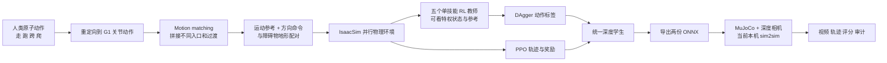
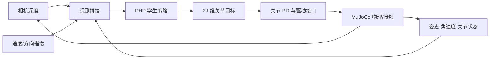
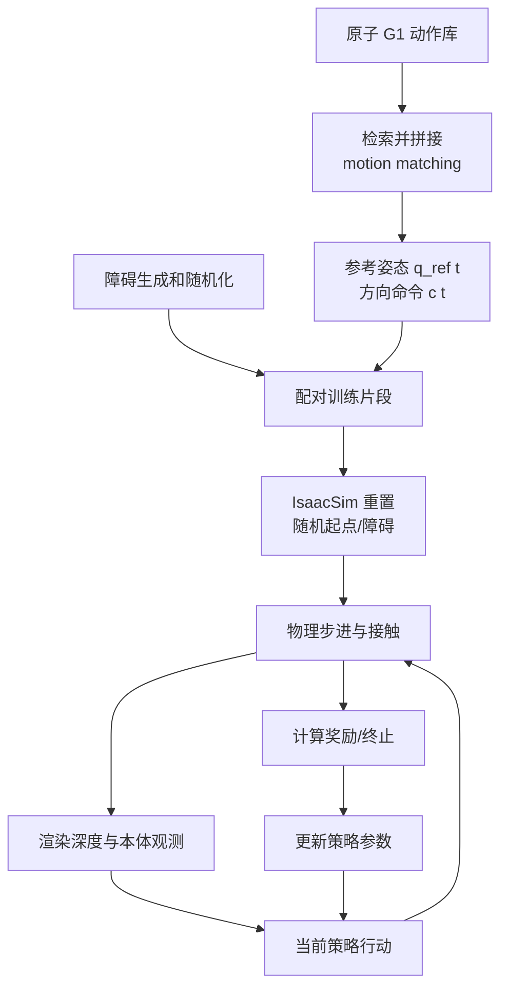
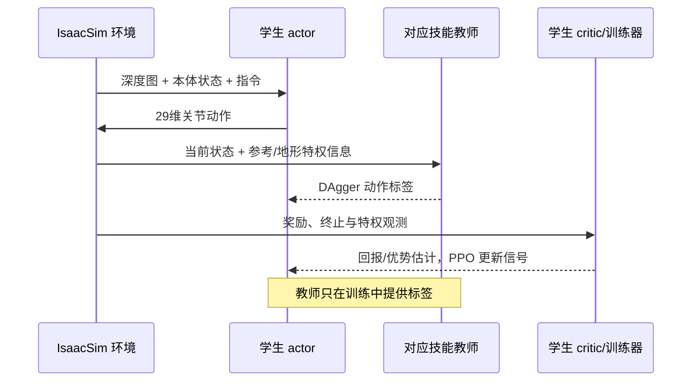
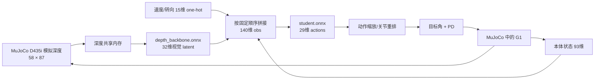
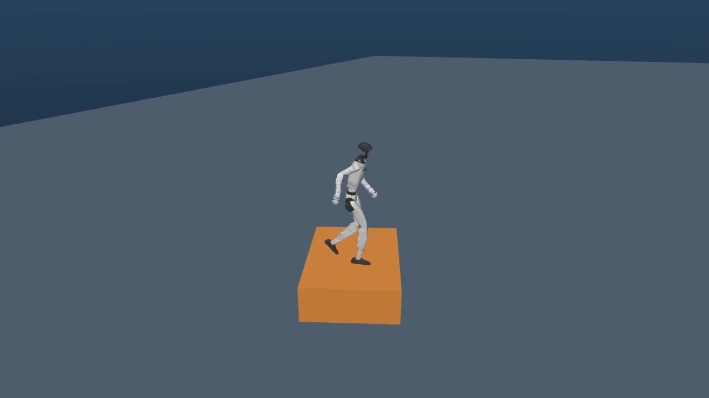
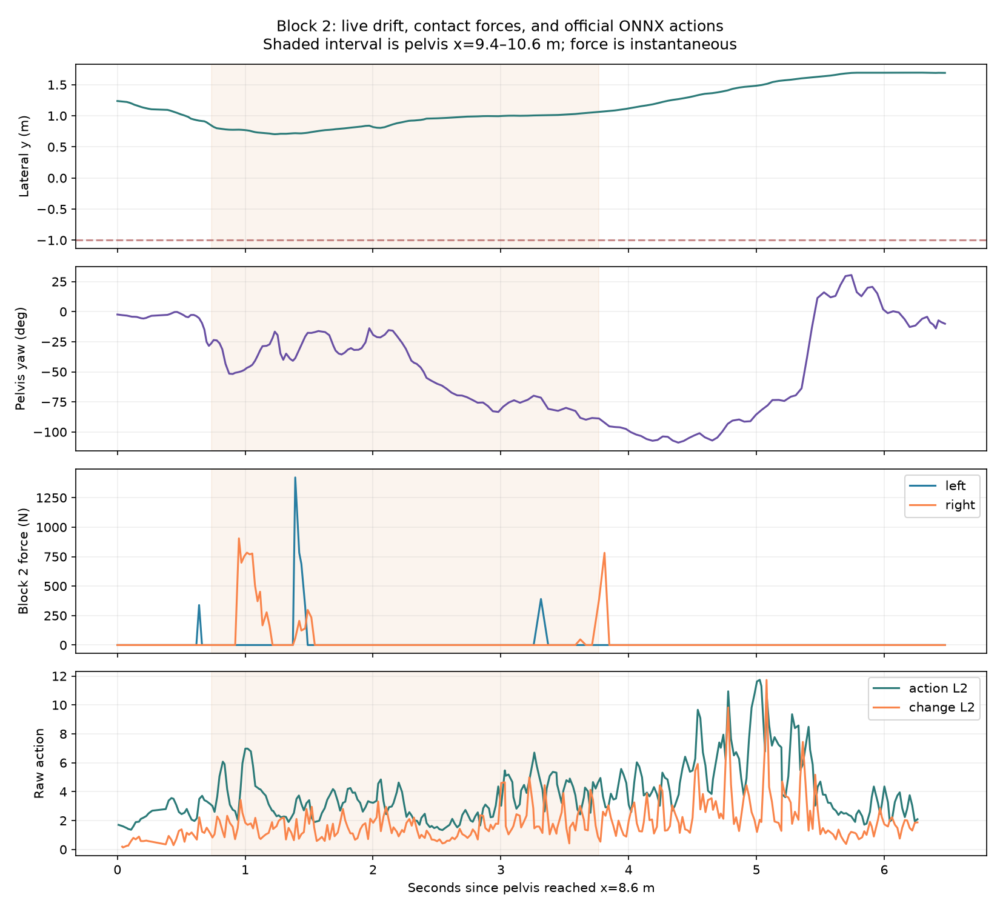
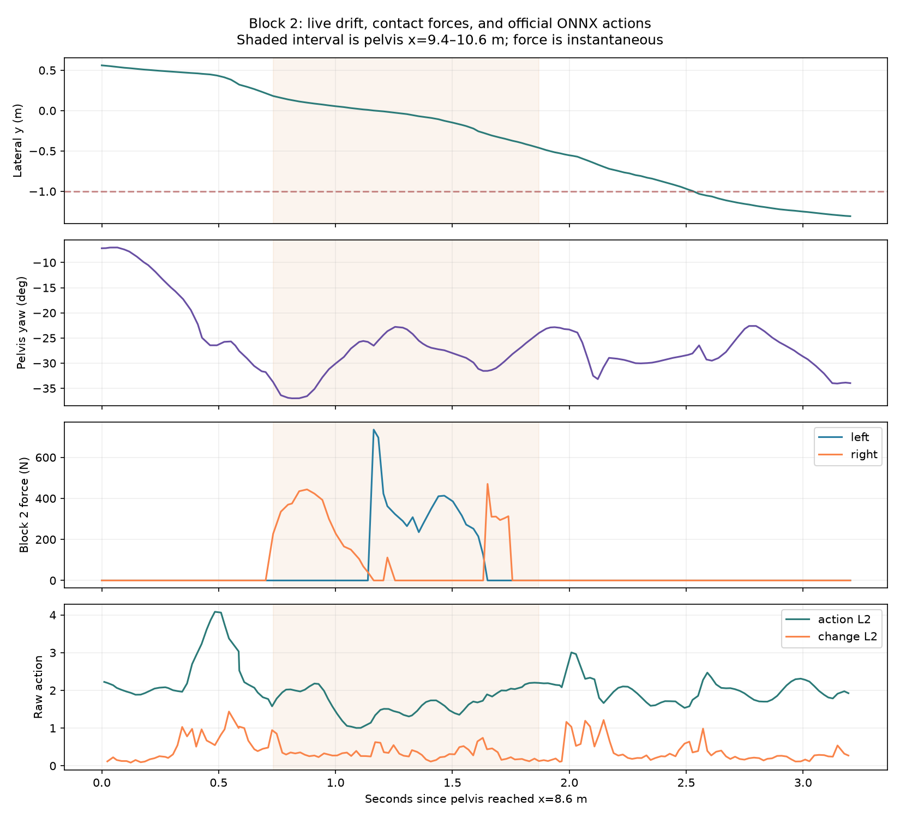

# PHP Parkour 项目总览：从动作数据、强化学习教师到双 ONNX 学生

> 更新于 2026-10-20。面向做过 π0.5、VLA 推理/数据工程，但尚未系统接触人形 locomotion、全身控制和强化学习的读者。本文是本仓库的**总入口**：把官方方法、这台机器已经完成的复现、尚未执行的训练，以及各项证据放在同一条逻辑线上。详细实验原始记录仍保留在文末链接，不把旧报告合并删除。

## 读这份文档时先记住三句话

1. **当前跑的是官方发布的学生推理权重，没有重新训练。** `depth_backbone.onnx` 与 `student.onnx` 是**一个**视觉学生策略的两个串联组件；“双”指两个 ONNX 文件，不是两个学生，更不是教师和学生各一个。官方[部署指南](wbt_training/DEPLOY.md)和[发布说明](https://github.com/amazon-far/php_parkour/releases/tag/student-assets-v1)都把它们作为一对发布。
2. **教师是训练期的单技能 RL 专家，不在当前 MuJoCo demo 中运行。** 训练教师用带参考动作和仿真地形真值的特权观测；统一学生训练时用教师动作作 DAgger 标签，同时用 PPO 的成败反馈继续学习。发布包没有教师 `.pt` 或可恢复训练的学生 `.pt`。[官方项目概览](https://github.com/amazon-far/php_parkour)、[训练指南](wbt_training/README.md)。
3. **G1/Unitree 接口 ≠ 宇树官方预训练 RL 行走策略。** 当前闭环的关节动作由 PHP 学生 ONNX 给出，Holosoma 处理观测、关节映射、通信及 PD 执行，MuJoCo 模拟机器人与接触。`far-unitree-sdk`/`unitree_interface` 在这里承担兼容宇树低层消息的桥接角色；本地运行证据没有显示调用宇树另一个高层 RL locomotion 权重。下文会把“机器人型号”“通信接口”“非学习 PD”和“学习策略”分开。[推理实现](thirdparty/holosoma/src/holosoma_inference/holosoma_inference/policies/depth_distillation.py)、[桥接实现](thirdparty/holosoma/src/holosoma/holosoma/bridge/unitree/unitree_sdk2py_bridge.py)。

**本机阶段结论：** 官方 ONNX 已在 `php` mamba 环境和隔离显示器 `:99` 的 MuJoCo 中闭环运行，并有原始深度、策略动作、关节状态、接触及版本化视频证据；默认 12 块路线尚未复现官方展示。历史最好的一次质量合格、带**外部**方向引导的短程试次连续通过前 5 块（025，尚未证明稳定）。最近的 012 按方块位置引导试次踏上第二块，却在首次出块前摔倒，严格只通过第 1 块。用户要求的稳定跨过第 2 块尚未实现；保守引导候选因共享主机负载被预检阻断，尚无成绩。见[试验流水账](PHASE1_TRIAL_LOG.md)、[012 视频与交互回放](demos/phase1-onnx-block-aware-v1/README.md)、[最近诊断报告](reports/phase1_block_aware_2026-10-19.md)。**第二阶段教师/学生重新训练尚未开始。**

## 目录

- [一张总图：整个系统在做什么](#一张总图整个系统在做什么)
- [与 VLA 相比，locomotion 的难点在哪里](#与-vla-相比locomotion-的难点在哪里)
- [训练需要什么数据，数据从哪里来](#训练需要什么数据数据从哪里来)
- [仿真如何训练五位教师](#仿真如何训练五位教师)
- [如何蒸馏统一的深度学生](#如何蒸馏统一的深度学生)
- [双 ONNX 在推理时如何连接](#双-onnx-在推理时如何连接)
- [宇树 G1、Unitree 接口、PD 与 PHP RL 的边界](#宇树-g1unitree-接口pd-与-php-rl-的边界)
- [本机复现到哪里，差距如何解释](#本机复现到哪里差距如何解释)
- [复现证据和视频应如何读](#复现证据和视频应如何读)
- [代码地图与延伸阅读](#代码地图与延伸阅读)

## 一张总图：整个系统在做什么



官方论文把方法分成 motion matching、特权教师 RL、DAgger+RL 学生三段；学生只用机载深度感知和离散二维速度方向命令，在训练后的执行环节自主选择越障动作。[论文概览及方法](https://arxiv.org/html/2602.15827v2)。**“生成参考动作”并不等于“已经学会控制机器人”**：运动参考可以在画面里很好看，脚一接触地面仍可能滑、穿模、失衡；教师和学生才是在有质量、惯量、电机、接触力的仿真里学闭环控制。


*图 1：官方仓库提供的示例，用来理解目标动作类型；本文后面的本机视频有独立评分，不能把这张展示图当成我们的复现结果。*[官方仓库](https://github.com/amazon-far/php_parkour)。

## 与 VLA 相比，locomotion 的难点在哪里

你熟悉的 VLA 往往把图像、语言和机器人本体状态映射到动作片段。PHP 的学生也能写成 `策略(观测, 指令) → 动作`，但动作作用在 **29 自由度、持续接触地面的动态人形身体**上；观测、动作和接触必须以几十到数百 Hz 的不同速率持续闭环。一次错误的脚落点会立刻改变之后所有帧的身体状态。这里不把“策略输出了合理动作”和“物理上真的跨过去”混为一谈。

| 如果你从 π0.5 / LeRobot 数据链来理解 | 在 PHP 中最接近的概念 | 关键新增问题 |
|---|---|---|
| 示教轨迹、action chunk | 运动匹配后的全身**参考**轨迹；学生每步关节动作 | 参考轨迹没有自动满足动力学和接触约束 |
| 相机图像 + 机器人状态 | 深度图 + 本体感觉 + 离散速度方向命令 | 相机看到障碍与脚真正接触之间有时延、遮挡和模型误差 |
| 离线行为克隆 loss | DAgger 的在线教师动作标签 | 学生走偏后，训练仍要覆盖自己造成的新状态 |
| 任务成功率评测 | PPO 回报 + 独立的跨障/站稳评分 | “动作像专家”与“全程没有摔倒”不是同一个目标 |

| 层次 | 这里的具体含义 | 常见误读 |
|---|---|---|
| 世界/仿真状态 `s_t` | 刚体位置、姿态、速度、地形、接触及参考动作进度等；训练器可访问 | 真实部署的学生并非全知 |
| 学生观测 `o_t` | 深度图、本体感觉、离散方向/速度指令及历史动作等，取决于部署配置 | 不是直接输入完整障碍物坐标 |
| 策略动作 `a_t` | 29 个归一化关节目标/偏移，经元数据缩放和关节重排 | 不是直接对每个电机输出最终力矩 |
| PD/执行器 | 按目标角与当前角/角速度计算驱动、施加到仿真关节 | PD 是低层伺服公式，不是额外的 RL 行走大脑 |
| 接触求解器 | 在脚、手、台阶和地面接触时更新力与运动 | 视觉上“踩到”不等于稳定越过 |

训练可以用离散时间循环理解：`o_t → πθ(o_t)=a_t → 物理推进 → s_{t+1}, r_t, done`。`r_t` 是**训练反馈**，部署 ONNX 时没有 PPO 更新。奖励与最终评测也不同：奖励帮助学习，最终仍应单独检查是否踩上、出块后是否站稳。更完整的 MDP/POMDP、PPO 和 PD 推导见[原有入门课](PHP_HUMANOID_LOCOMOTION_BEGINNER_GUIDE.md)。



上图是**部署闭环**。训练闭环额外有参考动作、奖励、教师、critic、优化器和多环境并行；它们不会因为运行一个 ONNX demo 就在后台发生。

## 训练需要什么数据，数据从哪里来

### 先区分三种常被混叫成“数据集”的东西

**原子动作库**是源素材：先有适合 G1 的走、跑、跨、爬动作片段以及对应的场景。这些动作源于人类动作，经机器人重定向；它们描述“希望身体怎样运动”，没有证明电机和物理接触能真的做到。官方允许把自己的 G1 `qpos` 源片段输入 motion matching：示例源片段为 30 FPS，单帧 `qpos` 长度 36，顺序是根部四元数 4、根部位置 3、29 个关节角；数据生成器会重采样到内部数据库。[官方 motion matching 指南](motion_matching/README.md)。

**配对的运动/地形训练包**是教师训练的离线输入：motion matching 在运动库里检索并拼接技能入口、出口和中间行走，生成具有不同接近距离、步态相位与转向的参考轨迹，再为其配上障碍地形。官方生成文件以 `*_motion.npz` 保存运动参考及有提供时的逐帧方向命令，以 `*_terrain.npy` 保存随机化的箱体地形；`*_terrain.obj` 供可视化。生成运动按 50 FPS 导出。`.npz` 和 `.npy` 是数据，**不是教师策略权重**。[官方生成格式](https://github.com/amazon-far/php_parkour/blob/main/motion_matching/README.md)。

**在线仿真采样**是 RL 真正反复消费的新数据：每次把参考和障碍放进 IsaacSim 后，由当前策略控制物理机器人，现场得到图像、关节状态、接触、奖励、是否终止，以及教师动作标签。它的分布会随策略学习而变化。只下载运动包不会自动得到一套固定的深度图/动作监督样本，也不能用运动 NPZ 直接替代 PPO rollout。学生训练深度相机组在代码中由 Warp 深度观测项生成 58×87 图像，并设置采样延迟等参数。[学生观测配置](wbt_training/config_values/depth_distillation.py)、[官方训练指南](https://github.com/amazon-far/php_parkour/blob/main/wbt_training/README.md)。

| 数据或文件 | 来自哪里 | 主要包含什么 | 谁使用 | 本次是否已有/已执行 |
|---|---|---|---|---|
| 人类技能/G1 原子动作数据库 | 采集、重定向、预处理；官方提供可下载数据库 | 姿态、关节轨迹、技能片段、可配对地形 | motion matching | 本轮第一阶段未重新生成数据库 |
| `*_motion.npz` + `*_terrain.npy` | motion matching 生成，或直接下载官方 prepared bundles | 随时间的 G1 运动参考/方向命令，及配对障碍几何 | 各单技能教师和之后的学生训练 | 五份官方示例包已下载并验哈希；**未据此启动训练** |
| 仿真真值与观测 | IsaacSim 环境实时计算/渲染 | 本体状态、参考误差、height scan、深度图、接触等 | 教师/学生/critic，各自能看到的字段不同 | 当前机器未运行 IsaacSim 训练 |
| 教师动作标签 | 已训练教师针对**学生当前走到的状态**在线推理 | 该状态下专家建议的 29 维动作 | DAgger 学生更新 | 官方未公开教师 checkpoint，因此本地尚无这类训练标签 |
| RL rollout 与奖励 | 当前学生在并行仿真环境自行行动 | `o_t,a_t,r_t,done`、回报/优势、失败与恢复状态 | PPO/critic 更新 | 尚未采集训练 rollout；MuJoCo demo 的轨迹仅用于评测与排障 |
| `.pt` checkpoint | 完整训练过程存盘 | 可恢复的策略参数以及训练相关状态，取决于存盘格式 | 评估、续训、导出 | 官方发布包没有原始教师或学生 `.pt`；本地没有自行训练 checkpoint |
| 双 `.onnx` | 将**训练好的学生**导出 | 部署用深度编码器与动作网络权重/接口元数据 | 当前 MuJoCo 推理 | 官方发布 pair 已下载并在本机运行 |

官方现成的五份运动/地形包分别是：普通行走 100 对、低速台阶 56 对、高速台阶 60 对、低速 76 cm 攀爬 40 对、高速 76 cm 攀爬 40 对，合计 **296 对**。这只是当前开放的示例训练资产，不能据此推断论文所有原始动作资料或全部地形类型都已公开；对应发布页明确称它们是训练数据而非教师 checkpoint。[官方数据说明](https://github.com/amazon-far/php_parkour/blob/main/wbt_training/README.md)、[数据发布页](https://github.com/amazon-far/php_parkour/releases/tag/training-motion-examples-v1)。

### 一条“跨第二块”训练样本会怎样产生

假设我们想训练低速跨一个台阶。motion matching 先从行走库选能衔接的步态，再接上跨台阶段落，然后恢复行走；系统同时保存方向命令与台阶形状。训练时 IsaacSim 随机选择某个参考轨迹和一个起始片段，放入其配对的障碍，重置 G1 身体状态，让**当前**教师输出关节目标。物理引擎每步计算机器人是否按参考姿态移动、脚和障碍怎样接触、有没有摔倒；这些成为下一步观测和奖励。教师反复经历不同入口、落脚和失败状态，参数才逐渐改变。

数据多样性直接影响策略是否只会背单一节奏。论文描述了不同接近距离、左右脚领先、速度/转向、地形宽度与朝向随机化；例如训练合成时使用两档速度和多个转向类别，并对障碍宽度、尺寸、朝向做扰动。[论文数据构造](https://arxiv.org/html/2602.15827v2)。**运动参考本身是运动学目标；稳定落脚、力矩和恢复能力要靠物理训练学出来。**



图中的训练期 `q_ref(t)` 不会成为部署学生的一条秘密输入；如果让部署网络直接读参考轨迹或仿真高度扫描，真实机器人就缺少这些真值，部署接口会失真。这正是特权教师与视觉学生分开的原因。

## 仿真如何训练五位教师

### 教师看到什么、做什么

PHP 不是先训练一个“万能宇树行走器”再装上去。当前开放配方使用五组运动/地形数据，各训练一个技能专家：普通行走、低速/高速跨台阶、低速/高速攀爬。每位教师都控制 G1 的关节目标，训练目标是在接触动力学下跟踪各自的参考轨迹，并尽量不摔倒、不越过关节和接触限制。[官方训练说明](https://github.com/amazon-far/php_parkour/blob/main/wbt_training/README.md)。

教师可见的**特权观测**包括参考关节位置/速度、骨盆相对参考的误差、机器人本身的关节与身体状态，以及近场高度扫描；论文还说明给专家使用全局骨盆位置和速度来学习恢复。所谓“特权”，不是教师用了外部 API，而是训练模拟器能够直接交出真实状态；真机上的相机与 IMU 不能直接提供完美地形网格和理想参考误差。[论文教师训练小节](https://arxiv.org/html/2602.15827v2)、[训练观测配置](wbt_training/config_values/terrain.py)。

一个教师的训练循环可以读成以下伪代码；它说明原理，不是让我们在当前办公机上启动训练的命令：

```text
初始化教师 actor、critic、优化器和 N 个并行 IsaacSim 环境
重复许多迭代：
    为每个环境选运动/地形配对、参考时刻、初态与随机参数
    用当前教师在环境中走一段：
        读取训练期特权观测与当前机器人状态
        教师输出 29 个关节动作目标；PD/物理引擎执行
        计算运动跟踪奖励、动作平滑/关节限制/碰撞约束、终止
    根据整段 rollout 估计回报与优势
    用 PPO 更新 actor 和 critic；保存指标和 .pt checkpoint
```

教师的奖励不只看“x 前进了多少”：它主要鼓励全身动作跟踪，兼顾动作变化、关节限制和不希望的碰撞。若只给前进奖励，机器人绕开台阶也可能得高分。对困难时间片，教师训练使用自适应采样，让失败频繁的阶段被更多次练习；训练还会随机化接触、初态或地形参数以减少对一个完美仿真的依赖。论文明确说明参考跟踪、height scan、自适应采样与奖励/终止设计。[论文 §III-C1](https://arxiv.org/html/2602.15827v2)。

PPO 只需先理解为“让策略朝整段表现更好的动作方向更新，同时限制单次更新幅度”；critic 估计未来表现，给 actor 一个优于/劣于预期的信号。训练的 `4096` 等并行环境数是**吞吐配置**，不是 4096 台真实 G1。论文与本仓库当前 preset 的迭代数/并行规模并不完全一样，将来若重新训练必须保存实际提交、配置快照、数据哈希、硬件、checkpoint 和评测协议，不能只写“按论文训练”。[本地配方审计](NEXT_STAGE_PLAN.md)、[PPO 原论文](https://arxiv.org/abs/1707.06347)。

教师 `.pt` 的价值是能被评估、用于学生动作标注，或在训练状态齐全时继续训练。现在官方发布的是五份**数据**和一对**学生推理 ONNX**，没有放出五位教师的可恢复 checkpoint。因此下一阶段若真的进入“按官方配方从头训练”，需要先建立 IsaacSim 环境并分别训练教师；无法把发布 ONNX 当作教师，也无法从不存在的官方教师 `.pt` 接着后训练。[官方学生发布说明](https://github.com/amazon-far/php_parkour/releases/tag/student-assets-v1)。

## 如何蒸馏统一的深度学生

教师单独熟练一项技能，但部署时我们希望一个策略用有限的传感器完成多种动作。学生蒸馏解决两个变化：**专家由多个变一个**，**输入由仿真真值变成可部署的深度图和本体状态**。训练配置明确分开四组：`actor_obs` 是学生本体状态及方向命令，`teacher_obs` 是可路由到某位教师的特权观测，`critic_obs` 是训练价值函数使用的特权观测，`depth_camera` 是仿真深度图。[官方观测配置](https://raw.githubusercontent.com/amazon-far/php_parkour/main/wbt_training/config_values/depth_distillation.py)。

| 角色 | 主要能看到什么 | 何时使用 |
|---|---|---|
| 单技能教师 | 当前参考运动、参考误差、仿真地形高度扫描、身体全局状态等 | 先通过 RL 训练；蒸馏时提供动作标签 |
| 学生 actor | 深度图编码、本体感觉（姿态线索、角速度、关节角/速度、上一动作）、方向/速度类别 | 蒸馏训练及最终部署 |
| 学生 critic | 训练器可提供的更完整仿真状态/地形信息 | PPO 训练时估值；不进入部署 ONNX 动作链 |
| 物理环境 | 所有刚体、接触、参考时刻、奖励/终止信息 | 推进训练；部署换成 MuJoCo 或真实物理世界 |

**DAgger 的关键是让学生先行动。** 若只在教师的完美轨迹上做监督，学生稍微踩偏后便进入训练集中没有的状态，误差会越滚越大。DAgger 让当前学生在仿真里走到自己的状态，再按运动类型询问对应教师“你会输出什么关节动作”，用这个标签更新学生。仓库中的 `which_motion` 用于选择对应专家；当学生已经离开专家可靠的参考区域时，该标签可能不可信，训练逻辑会屏蔽这一部分模仿损失。[本地路由与损失实现](wbt_training/utils/student_teacher.py)、[观测/路由配置](wbt_training/config_values/motion_command.py)、[DAgger 原论文](https://proceedings.mlr.press/v15/ross11a.html)。

只模仿教师动作仍可能在高墙攀爬的关键时刻给出偏弱动作：平均每帧看着“很像”，整段结果却失败。PHP 因此**在学生蒸馏过程中同时加入 PPO**，用整段越障回报纠正单纯模仿的保守性。它不是“先训练发布 ONNX，再拿这两份 ONNX 单独做一次后训练”；需要可训练学生、critic、教师标签和环境 rollout。论文给出的概念性目标是 `L = λ_D·L_DAgger + λ_PPO·L_PPO`，并随训练调节权重。[论文蒸馏小节](https://arxiv.org/html/2602.15827v2)。



学生训练结束后导出部署文件；官方训练脚本可在保存学生 checkpoint 时生成 `depth_backbone.onnx` 和 `student.onnx`。完整训练 `.pt` 与导出的 ONNX 作用不同：ONNX 是冻结的推理图，通常没有让你从某次 PPO 更新继续所需的 optimizer/critic 状态。公开 release 只保留导出的这对推理文件，故本地现在能做的是**推理复现**，不是严格意义上的官方 checkpoint 续训。[官方训练与导出说明](https://github.com/amazon-far/php_parkour/blob/main/wbt_training/README.md)、[发布说明](https://github.com/amazon-far/php_parkour/releases/tag/student-assets-v1)。

## 双 ONNX 在推理时如何连接

“双”只数文件。`depth_backbone.onnx` 是视觉编码器，`student.onnx` 是用视觉特征加身体状态产生关节动作的网络；官方推理类要求按这个顺序给出**恰好两个路径**，并明确说明它们构成一个组合策略。[官方部署指南](https://github.com/amazon-far/php_parkour/blob/main/wbt_training/DEPLOY.md)、[本地推理类](thirdparty/holosoma/src/holosoma_inference/holosoma_inference/policies/depth_distillation.py)。

本机读取官方发布 ONNX 的实际 I/O 元数据得到下表。`student.onnx` 导出时还带有若干身体状态辅助输出；当前运行时真正取用于控制的是 `actions`，不能把所有 ONNX 输出都当作发给电机的命令。

| 文件 | 输入 | 输出中用于部署主链的部分 | 含义 |
|---|---|---|---|
| `depth_backbone.onnx` | `depth_image`: `[1,58,87]` | `depth_latent`: `[1,32]` | 从深度图抽取视觉特征 |
| `student.onnx` | `obs`: `[1,140]`；`time_step`: `[1,1]` | `actions`: `[1,29]` | 合并特征与指令，给 G1 的 29 个关节产生动作 |

在当前配置下，可以用维度帮助记忆 `obs`：本体状态约 93 维（重力方向提示 3、角速度 3、关节角 29、关节速度 29、上一步动作 29），方向/速度 one-hot 15 维，视觉潜变量 32 维，合为 `93+15+32=140`。**维度正确还不够**：观测顺序、坐标系、关节顺序、动作缩放、相机外参/深度归一化、控制频率都必须与权重匹配。部署类会从 ONNX 元数据读取关节名与动作缩放，并将模型顺序和机器人顺序互相映射；当前运行时给可选的 `time_step` 输入填零。[推理观测与动作路径](thirdparty/holosoma/src/holosoma_inference/holosoma_inference/policies/depth_distillation.py)、[原有链路审计](reports/phase1_depth_pipeline_audit.md)。



图中的 `w/a/d` 是给策略的**离散运动方向命令**，不是自己手写 29 个关节目标。按方块几何选择短时 `a/d` 是我们附加的导航器，仍通过官方 ONNX 生成关节动作；因此结果必须标为“官方 ONNX + 外部引导”。W-only 才能检验在这个固定输入协议下，发布学生自己能走多远。[外部引导实现](scripts/php_block_guidance.py)、[012 试次报告](reports/phase1_block_aware_2026-10-19.md)。

这里还有一个容易误读的“二”：论文的“teacher–student 两阶段学习”和“部署时两份 ONNX”是**不同维度**。前者讨论训练角色，后者讨论同一个学生的部署文件划分。两份 ONNX 都属于学生，教师既不是 `depth_backbone.onnx`，也不是 `student.onnx`。

## 宇树 G1、Unitree 接口、PD 与 PHP RL 的边界

“用的是宇树机器人”可能指机器人外形、消息协议、电机内环，也可能指宇树发布的某个预训练行走策略。对**当前本地 MuJoCo 复现**，必须分别回答，不能把一项当成另一项。

| 部分 | 当前来源与作用 | 是否本次运行的学习控制策略？ |
|---|---|---|
| G1 形态、29 自由度与 MuJoCo XML | Holosoma 仿真资产规定关节、质量/碰撞等模拟对象 | 否；是被控制的身体模型 |
| `unitree_interface`、`far-unitree-sdk`、Holosoma bridge | 读/发兼容 Unitree 的低层状态和关节命令，让本地仿真、推理进程互联 | 否；接口与消息传输不等于预训练步态策略 |
| 关节 PD/驱动配置 | 根据目标角和关节状态计算驱动，增益由配置/模型元数据确定 | 否；这是低层伺服，不是本项目的 RL 策略 |
| PHP 五位教师 | 在 IsaacSim 训练的单技能 RL 专家，使用特权观测 | 训练期是；当前 demo 未加载 |
| PHP 双 ONNX 学生 | 深度编码器与统一动作网络，输出关节目标 | **是当前闭环的学习策略**；权重来自 PHP 官方 release |
| 我们的 `guided`/`block_aware` | 在策略输入层选离散转向类别，例如短时 `a/d` | 不是学习网络；属于额外外部导航规则 |

实际控制链可写为 `PHP ONNX → 关节目标 → Holosoma/Unitree 格式命令 → MuJoCo 关节与接触 → 状态/深度反馈`。源码中仿真 bridge 接收低层关节命令并计算模拟力矩，推理端接口读状态、写低层命令，PHP 推理类单独加载两份 ONNX。这些文件是判断控制权的直接证据：[仿真 bridge](thirdparty/holosoma/src/holosoma/holosoma/bridge/unitree/unitree_sdk2py_bridge.py)、[推理端接口](thirdparty/holosoma/src/holosoma_inference/holosoma_inference/sdk/unitree/unitree_interface.py)、[策略加载](thirdparty/holosoma/src/holosoma_inference/holosoma_inference/policies/depth_distillation.py)。

因此，**不能说“我们在用宇树官方本地 RL 行走控制器完成跨障”**。已检查的当前推理路径没有加载另一个 Unitree 预训练 locomotion 权重，关节动作由 PHP ONNX 决定。这不否认 G1 型号、兼容消息和驱动参数的重要性；它们与“谁决定下一步关节目标”处于不同层。纯 MuJoCo 测试也不能推断真机内部未公开的电机固件与安全逻辑。本次没有连接真实 G1，更没有真机控制。[官方 MuJoCo 部署指南](https://github.com/amazon-far/php_parkour/blob/main/wbt_training/DEPLOY.md)。

## 本机复现到哪里，差距如何解释

当前第一阶段是“使用官方发布权重做可核对的 MuJoCo 推理”；第二阶段才是“按官方数据和训练配方从零训练教师，再蒸馏学生”。这轮用户要求先整理文档，因此**没有启动下一阶段仿真或训练**。[第一阶段计划](PHASE1_REPRODUCTION_PLAN.md)、[完整阶段计划](NEXT_STAGE_PLAN.md)。

| 状态 | 已得到的证据 | 能下的结论 |
|---|---|---|
| 环境/接口 | `php` mamba 环境；官方 ONNX 校验；隔离 `:99` 显示器；深度、动作和接触记录 | 官方学生在本机确实能闭环推理 |
| W-only 固定输入 | 历史试次 038 严格连续 2 块；独立诊断 010 踩上第 2 块却在首次出块 y=−1.282 m 偏出 | 第二块有时能过、有时失败；尚未稳定 |
| 外部 `guided` 历史最好 | 025 短程、质量合格，连续前 5 块；同配置之后的 030/031 只有 2/1 块 | 5 块是含外部方向输入的**单次最好案例**，不代表稳定能力 |
| 外部方块位置引导 | 012 真实发出 6 次方向短按、踩上第二块，进块后失稳；013 保守候选因共享主机负载未启动 | 尚未达到“稳定跨过第二块”的要求 |
| 重新训练 | 五份官方示例数据已下载/校验；没有公开教师 checkpoint，尚无新 `.pt` | 教师与学生均**未重新训练** |

本机评分把“登上”和“跨过”分开。前者主要看骨盆进入台阶平面并抬高；后者看首次经过台阶尾端再前进 1.5 m 时是否仍有足够高度且横向在路线内。脚部原求解器接触可作补充证据。**最大 x 和视频里的踩台阶画面，都不能替代首次出块评分。** 这套判据是本机评测定义，不等于论文指标。[评分器](scripts/php_score_course.py)、[第二块同次取证](reports/phase1_second_block_live_trace_2026-10-19.md)。

论文仿真量化采用给定速度、随机初始距离/朝向的**单障碍**任务；论文也展示真机长程多障碍。我们的默认 12 块 MuJoCo 路线与论文 IsaacSim/真机协议不同。公开 ONNX 还移除了导出来源信息，不能证明它与官方每一段视频是完全相同的训练检查点。差距真实存在，但现有证据不足以把原因归给一个确定的深度外参、关节增益、权重版本或地形参数。[论文实验设置](https://arxiv.org/html/2602.15827v2)、[模型发布说明](https://github.com/amazon-far/php_parkour/releases/tag/student-assets-v1)。



*图 2：本机 012 试次的 MuJoCo 实体台阶预览。它使用官方 ONNX 加外部方块位置引导；画面不能替代第二块出块评分。[看同次 30 fps 视频与交互回放](demos/phase1-onnx-block-aware-v1/README.md)。*



*图 3：012 的横向位置、偏航、脚/台阶接触力和动作时间轴；力是离散采样而非完整接触冲量。反复方向短按与失稳在同次轨迹中出现，但单条轨迹不能分解每个动作的因果贡献。[数值及限制](reports/phase1_block_aware_2026-10-19.md)。*

## 复现证据和视频应如何读

一次可审查的版本应保存：官方模型与代码哈希、地形、起步条件、用户/外部方向输入、原始骨盆轨迹、关节状态、深度链路审计、速度/帧率、逐块评分、真实接触证据及同次视频。我们把原始窗口录制和保存状态的高清回放同时留下：**30 fps 成片是同一次仿真状态的可视化，不表示策略在 30 Hz 运行，更不是重新运行 ONNX**。这解释了旧录屏看起来卡顿而新版成片更流畅的原因；成片不能改变控制或物理结果。[版本演示方法](DEMO_VIDEO_WORKFLOW.md)。

在本机可查看 012 的实体仿真视频 `demos/phase1-onnx-block-aware-v1/demo.mp4`；若要拖动、缩放同一条保存状态，先确认 `:99` 没有其他运行，再从仓库根目录执行：

```bash
/home/xense/miniforge3/envs/php/bin/python scripts/php_open_demo.py \
  --trial demos/phase1-onnx-block-aware-v1
```

网页中左键拖动旋转、滚轮缩放，空格暂停/播放；退出终端时关闭回放进程。这个回放仅在独立虚拟显示器上运行，不截图办公桌面。`demos/版本ID/manifest.json` 保存视频、模型、状态与评分的哈希和参数；对应原始试验记录还在本机 `outputs/reproduction/`。用户要求的“每版本都有演示”以这种可追溯包为准；质量不合格或失败试次必须照实标注。[演示流程](DEMO_VIDEO_WORKFLOW.md)。

读结果时建议按这个顺序：先看 `audit.json` 是否 `nominal`、起步是否合格；再看 `result.json` 实际输入事件（有没有 `a/d`，脉冲真正持续多久）；再看 `course_score.json` 每块的 `mounted`/`cleared` 和**首次**出块 y；最后用视频、`pelvis.csv`、`qpos.csv`、求解器接触和 `inference.log` 解释失败模式。不同控制入口、不同资源门槛或带旁路录制的诊断试次，不能直接合并成一个稳定成功率。[010 同次深度/动作/接触诊断](reports/phase1_second_block_live_trace_2026-10-19.md)、[试验流水账](PHASE1_TRIAL_LOG.md)。



*图 4：W-only 010 的第二块前后轨迹。与图 3 的外部引导 012 要分开解读：010 在该窗口内只收 LOW forward，已经出现负向偏航和出块侧偏；012 又加入了左右短按，产生另一种摔倒路径。[010 报告](reports/phase1_second_block_live_trace_2026-10-19.md)。*

## 哪些会重新训练，哪些只要配置或复用

| 对象 | 当前第一阶段 | 将来按官方配方重新训练时 |
|---|---|---|
| 人类动作/G1 原子片段、运动匹配数据库 | 用官方准备好的运动/地形包即可理解配方；当前 demo 不调用 | 若追求完整数据生成可重跑 motion matching；也可以从官方 prepared bundles 起步，跳过生成 |
| IsaacSim 教师 actor/critic | **没有**；不能从官方发布资产加载教师 | 五类技能分别训练，产生各自 `.pt` 与评测曲线 |
| 深度学生 actor/critic/编码器 | 不更新参数；只加载官方双 ONNX | 用五位教师、数据、DAgger+PPO 从头训练可恢复 `.pt`，再导出新的双 ONNX |
| MuJoCo/IsaacSim 物理、G1 模型、深度相机、SDK bridge | 安装/选择配置并保持可审计 | 仍是环境和接口；会做配置/域随机化，但不是“训练一个宇树官方控制器” |
| PD 增益、动作缩放和关节映射 | 从官方配置/ONNX 元数据核对后执行 | 需要与训练/导出约定一致；参数调整是工程配置，不能冒充策略重新训练 |
| `guided`/`block_aware` | 额外方向输入规则，单独评估 | 若未来想做可学习的导航器，应另立目标、数据和评测；它不是当前官方学生训练的一部分 |

这张表也回答“哪些是用宇树官方本地 RL 运动控制器”：**当前证据链里没有那样一份被加载的独立 RL 权重**。若将来确实接入第三方现成运动控制器，应在运行日志里记录模型文件、接口、控制权切换点及其单独成绩；否则所有关节决策仍应归于 PHP 双 ONNX。当前发布资产的范围见[官方 release](https://github.com/amazon-far/php_parkour/releases/tag/student-assets-v1)。

## 代码地图与延伸阅读

| 想弄清的问题 | 优先读 |
|---|---|
| 三阶段与论文目标 | [官方 README](README.md)、[论文 HTML](https://arxiv.org/html/2602.15827v2)、[原有入门理论课](PHP_HUMANOID_LOCOMOTION_BEGINNER_GUIDE.md) |
| 动作片段怎样生成、`.npz/.npy/.obj` 是什么 | [motion matching 指南](motion_matching/README.md)、[官方数据集说明](https://github.com/amazon-far/php_parkour/blob/main/wbt_training/README.md) |
| 教师观测、奖励、地形随机化 | [terrain.py](wbt_training/config_values/terrain.py)、[experiment.py](wbt_training/config_values/experiment.py)、[教师启动器](wbt_training/training_runs/run_terrain_teacher.sh) |
| 学生四组观测、教师路由、DAgger/PPO | [depth_distillation.py 配置](wbt_training/config_values/depth_distillation.py)、[student_teacher.py](wbt_training/utils/student_teacher.py)、[学生启动器](wbt_training/training_runs/run_terrain_warp_distill.sh) |
| 双 ONNX 如何部署、29 关节动作从何而来 | [官方部署指南](wbt_training/DEPLOY.md)、[Holosoma 推理策略](thirdparty/holosoma/src/holosoma_inference/holosoma_inference/policies/depth_distillation.py)、[复现命令和环境问题](PHP_REPRODUCTION_GUIDE.md) |
| Unitree 消息桥和 PD | [仿真 bridge](thirdparty/holosoma/src/holosoma/holosoma/bridge/unitree/unitree_sdk2py_bridge.py)、[推理端接口](thirdparty/holosoma/src/holosoma_inference/holosoma_inference/sdk/unitree/unitree_interface.py) |
| 当前到底走过几块、为何失败 | [逐试次流水账](PHASE1_TRIAL_LOG.md)、[012 第二块报告](reports/phase1_block_aware_2026-10-19.md)、[所有版本视频](DEMO_VIDEO_WORKFLOW.md) |
| 若以后启动从零训练，机器和依赖够不够 | [训练环境审计](reports/training_setup_audit.md)、[下一阶段计划](NEXT_STAGE_PLAN.md) |

推荐阅读顺序是：先沿本页两张数据流图辨清“离线参考数据、在线训练数据、冻结 ONNX”，再打开一个[可拖动的同次视频](demos/phase1-onnx-block-aware-v1/README.md)看关节/台阶实际发生了什么，然后读推理代码的 `prepare_obs_for_rl` 与 `rl_inference`，最后再读教师奖励和 PPO/DAgger 细节。这样每个抽象术语都能对应到一个具体文件、信号或评测结果。
