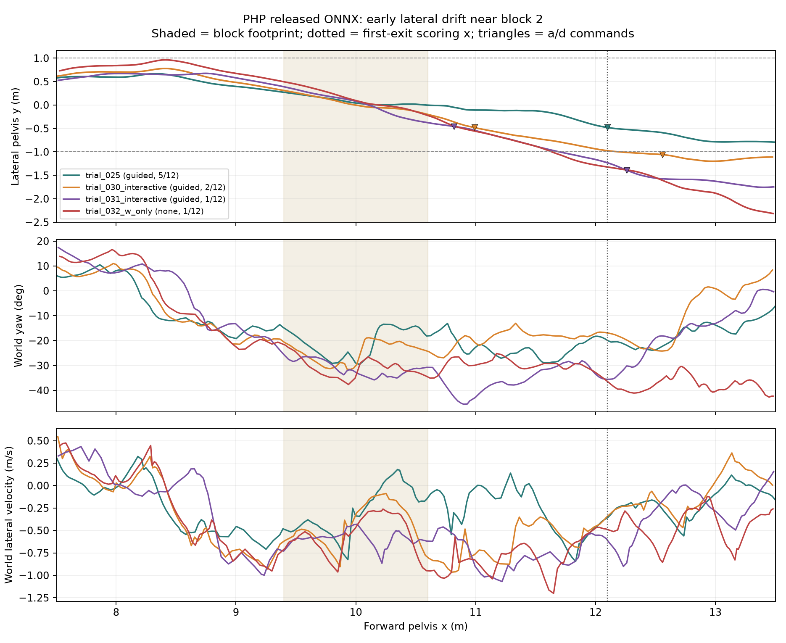

# 发布 ONNX 在第二块附近的横向漂移：历史轨迹离线对照

2026-10-15，分析对象为试次 025、030、031、032 的原始 `pelvis.csv`、方向事件和严格逐块评分。图由 [分析脚本](../scripts/php_analyze_early_drift.py)从原始文件生成；[逐点数值与文件哈希](phase1_early_drift.json)可供复核。



图中浅色带是第 2 块在 x=9.4–10.6 m 的投影，点线是首次离开判据对应的 x≈12.1 m，倒三角标记记录到的 `a/d` 修正命令。绘制的是机器人**首次到达** x=13.5 m 前的一段轨迹；曲线不能表示脚掌接触或视觉深度内容。

| 试次 | 输入 | x≈10 m：y / 偏航 | x≈10.8 m：y / 偏航 | 第 2 块首次出块 y | 本次连续通过 |
|---|---|---|---:|---:|---:|
| 025 | `guided` | +0.033 m / −29.6° | −0.048 m / −18.0° | −0.481 m | 5/12 |
| 030 | `guided` | −0.006 m / −29.6° | −0.347 m / −23.6° | −0.980 m | 2/12 |
| 031 | `guided` | +0.075 m / −33.2° | −0.458 m / −42.8° | −1.246 m | 1/12 |
| 032 | W-only | +0.069 m / −29.0° | −0.454 m / −26.6° | −1.342 m | 1/12 |

在 x≈10 m 四条轨迹都接近中线，且偏航同为明显负角；到 x≈10.8 m，025 的横向偏移尚小，另外三条已偏到 −0.35 至 −0.46 m。025 的第一条 `a/d` 事件在 x≈12.10 m，030 在 x≈10.99 m，031 在 x≈10.82 m，032 从未发送左右修正。因此至少**025 与其他试次的早期状态差异，不能只用第一次额外方向短按来解释**。这可能涉及第二块接触、初始状态、传感器/执行器时序或仿真入口差异；当前数据没有隔离这些因素，不能据此认定哪一个是原因。

025 使用旧的原始仿真入口和 `--demo-view`，030–032 使用记录完整状态的 `--interactive-demo`；031 的目标距离还与其余三条不同。图是排障线索，不是 W-only 与 `guided` 的受控效应估计。下一轮首先在同一入口/同一脚本下交错复测，重点保存 x=8、10、10.8、12.1 m 首次到达时的本体观测、深度帧时间、偏航、世界系横向速度、第二块的接触以及每个方向事件。第 2 块尚未稳定前，不宜凭旧 5/12 最好试次调第 5 或第 6 块的控制。

重新生成：

```bash
/home/xense/miniforge3/envs/php/bin/python scripts/php_analyze_early_drift.py
```
