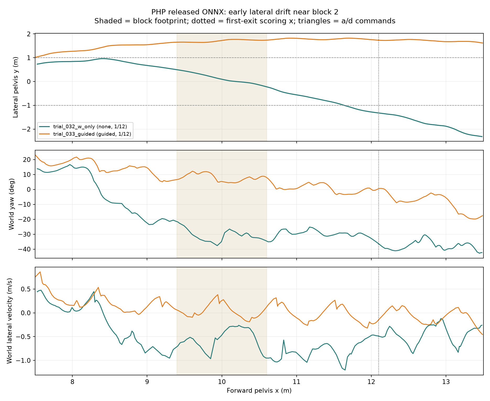

# 同一交互入口的第二块前轨迹探针（032–035）

2026-10-15。下面只比较官方发布双 ONNX、同一 `php_official_benchmark.py` 哈希 `ec74fad60e7fe844a8101beef3c9ddcb7eef7e8f885040a7ecc3f55a897ed556`、默认 12 块地形和 `--interactive-demo` 的已记录试次。032 与 033 均通过运行质量审计，均严格连续通过 **1/12**；034、035 有连续仿真降速，**不计入控制方式对照**。原始数据在本机被 Git 忽略的 `outputs/reproduction/official_benchmark/`，图和 [逐点数值及轨迹哈希](phase1_same_entry_probe.json)可复核。

| 试次 | 输入 | x≈8 m 的 y / 偏航 | x≈10.8 m 的 y / 偏航 | 第二块判断 | 首次 `a/d` |
|---|---|---|---|---|---|
| 032 | 只保持 W | +0.844 m / +14.4° | −0.454 m / −26.6° | 首次出块 y=−1.342 m，越界 | 无 |
| 033 | `guided`，上限 0.16 s | +1.274 m / +21.1° | +1.798 m / +0.6° | 旁侧接近，未登上 | x≈15.29 m |

033 在任何额外左右短按前已与 032 朝相反方向侧移；033 的首块出块 y=+0.859 m，032 是 +0.580 m。两次开局偏航分别为 +0.23°、−0.13°，都在 ±2° 门槛内。相同脚本和权重让旧试次 025 与新试次之间的“入口不同”混杂减少，但**不能由一对不同输入标签的试次证明随机性来源或控制器效果**：仍要核对释放时完整关节状态、深度首帧、接触和每个输入事件，而不仅是开局骨盆偏航。033 的第一次 `a/d` 很晚，因此这次早期分叉至少不能由已记录的人工方向短按直接造成。

又读取了两次 `qpos.csv` 的首个状态样本（行走时间 032 为 0.00054 s、033 为 0.01381 s；仿真时间相差 0.064 s）：根部 xyz 最大差 0.001802 m，29 个非根部位置坐标的差值 RMS 为 0.002540 rad、最大 0.005696 rad。即开局**位置姿态近似**，尚不能认定完整动力学初值相同；这里没有比较关节速度、接触冲量或首批深度像素与时间戳。两份 `qpos.csv` 的 SHA-256 分别为 `38a52ccb075dcd1db02917778761ec503e94567db9f5a57c89e26cf7407b7138`（032）、`a7fd30fd575cba127fad11d48e23efebbbbbb6c0cc61f491eb6601b8f183f2af`（033）。推理日志在行走开始后均先进入 `forward`，033 到 x≈15.29 m 才首次切换方向。

`pelvis.csv` 的首包世界系速度也接近：032 为 `(vx,vy,vz)=(0.1170,0.0079,0.0003)` m/s，033 为 `(0.1269,0.0086,0.0003)` m/s；行走前 0.5 秒各 17 个采样的横向速度均值分别为 +0.0295、+0.0375 m/s。这只覆盖骨盆平移，不包含 29 个关节的真实 `qvel` 或足端接触冲量。

本轮交错运行器先得到 033 `guided`：`nominal`、1/12、原始窗口录屏完整。034 W-only 在 304.4、345.7 Hz 连续降速，在线保护终止；延长预检后补跑的 035 W-only 在 210.7、198.2 Hz 连续降速，成绩 0/12，也应排除。两次启动前 GPU 利用率都低于 60%，说明**启动前瞬时低负载不足以保证整个行走窗口稳定**。033 的仿真速率中位数 498.9 Hz、最低 420.5 Hz；当前没有新的有效 W-only 复测，也没有证据表明发布模型在完整路线上的效果提高。

035 暴露了审计边界问题：基准程序把结束时间截到整秒，最后一次在线低速报告发生在同一秒内较晚的毫秒，旧离线审计窗口漏掉它，误标 `nominal`。已修改 [审计器](../scripts/php_audit_trial.py)使在线保护的停止原因优先，并增加 [回归测试](../tests/test_php_audit_trial.py)。本地 035 的 `audit.json` 已重算为 `sustained_sim_slowdown`；原批次 JSON 保留当时错误分类作为历史证据，不能作为最终质量标签。新的批次运行器也会把在线停止原因作为停止门槛。

后续先在低负载时间窗补 W-only 有效试次。[脚与台阶接触的离线重建](phase1_contact_replay.md)显示，032 在第二块有脚部几何接触，033 在保存的状态帧中没有；这把排障重点移到第一块出块后的状态演化。历史试次没有保存原始接触力和深度帧，需在单独诊断版本中取证。复测数达到计划中的最低数量后，再定代表视频和下一版本；不能只挑成绩最好的一条剪辑。`php-train`/IsaacSim 的 T0 隔离安装尚未开始。
